# Kingdom Forge Adventure

**Erz abbauen, schmieden, verkaufen, automatisieren!**

Du bist ein Zwerg und übernimmst die alte Schmiede im Bergdorf Tiefenbrunn. Du gräbst Erz in der Mine, schmilzt es zu Barren und schmiedest daraus Schwerter, Äxte, Helme und Spitzhacken. Im eigenen Laden handelst du mit der Kundschaft um jeden Preis. Mit jedem guten Stück wächst dein Ruf. Bald arbeiten Gehilfen für dich, Bohrer fressen sich durch den Fels, und irgendwann reitest du in die Marktstadt Eisenfurt und weiter in die Residenzstadt Hohenkron.

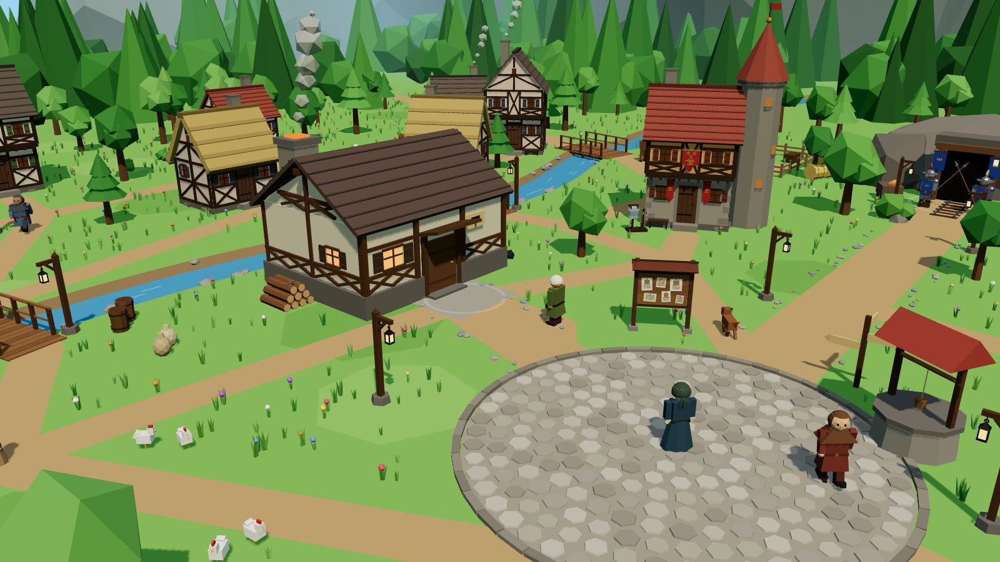

## Herunterladen

**[KingdomForgeAdventure-Setup.exe](https://github.com/pascalbuthut/kingdom-forge-adventure/releases/latest/download/KingdomForgeAdventure-Setup.exe)** herunterladen und starten. Das Spiel installiert sich mit einem Klick und legt eine Verknüpfung auf dem Desktop an.

- Neue Versionen holt sich das Spiel selbst. Sie werden beim Beenden installiert.
- Windows warnt beim ersten Start, weil das Spiel nicht signiert ist: „Weitere Informationen“, dann „Trotzdem ausführen“.
- Die Spielstände liegen unter `%APPDATA%\Kingdom Forge Adventure` und bleiben auch beim Deinstallieren erhalten.
- Alle Versionen stehen unter [Releases](https://github.com/pascalbuthut/kingdom-forge-adventure/releases). Dort gibt es das Spiel auch als Zip ohne Installation.

Das Spiel gibt es auf Deutsch und Englisch (Einstellungen, Sprache). Es läuft unter Windows.

## So spielt es sich

### Graben

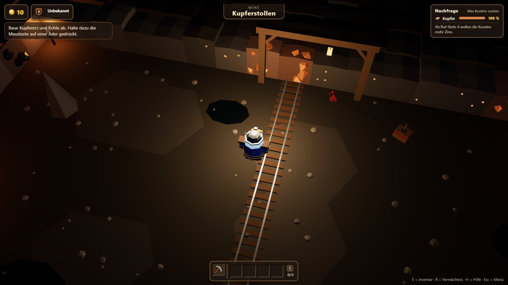

Die Mine ist ein Raster aus Fels, das du Feld für Feld abbaust. Kupfer, Zinn und Kohle stecken in Adern, die du an ihren Spuren im Gestein erkennst. Mit etwas Glück findest du Gold, Juwelen oder eine Kristallhöhle mit alten Werkzeugen. Tiefer im Berg sperren Felsriegel neue Schichten ab, bis dein Ruf groß genug ist. Mit der Zündkiste sprengst du den Stollen und fängst in einem neuen Berg von vorn an.

### Schmieden

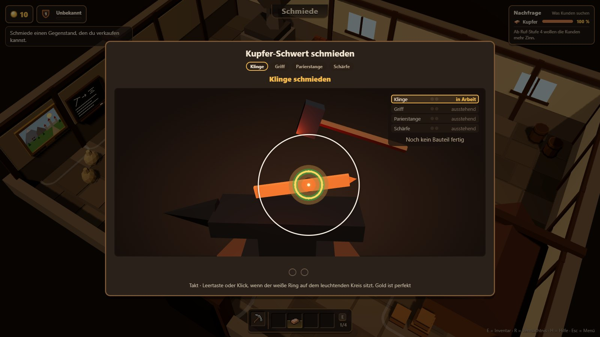

Jedes Stück besteht aus vier Bauteilen, und jedes Bauteil ist ein eigenes kleines Spiel: im Takt hämmern, in der Esse auf die richtige Hitze bringen, in der Presse mit Gefühl drücken, am Schleifstein der Linie folgen. Zum Schluss tauchst du das glühende Stück ins Wasser und siehst die Note, von Pfusch bis Meisterwerk. An der Werkbank besserst du einzelne Bauteile nach oder veredelst das Stück mit einer Goldzier und einem Juwel. Mit dem Meisterbrief machst du dort perfekte Bauteile meisterlich.

### Verkaufen

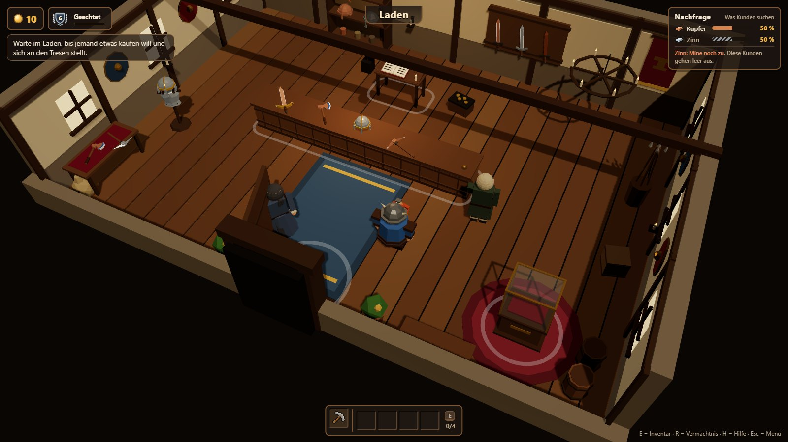

Die Kundschaft stöbert durch deine Auslage und tritt an den Tresen, wenn ihr etwas gefällt. Du nennst den Preis, sie handeln dagegen. Jeder Dorfbewohner hat seinen eigenen Geldbeutel, Geschmack und Sinn für Qualität, und er erinnert sich an dich. Das Verkaufsbuch hält jeden Handel fest. Mit Briefen im Postkasten kommen Spezialaufträge für ganz bestimmte Stücke.

### Ausbauen und automatisieren

Gold und Ruf öffnen neue Rezepte, Werkzeuge und Helfer. An der Anschlagtafel heuerst du Leute an: Der Gehilfe füttert den Ofen, der Bote holt Barren vom Alchemisten, der Fuhrknecht fährt das Erz aus der Mine, der Ladenbursche füllt die Auslage, und ein Verkäufer handelt für dich. Beim Bergamt kaufst du Bohrrechte, dann holen Bohrer und Loren das Erz von selbst.

### Die Marktstadt Eisenfurt

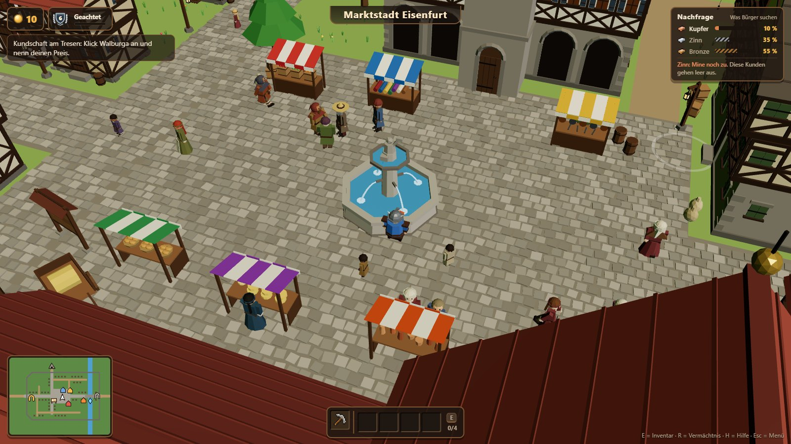

Reicht dein Ruf über das Tal hinaus, reitest du in die Stadt. Dort gibt es mehr Kundschaft mit dickeren Geldbeuteln, eine Große Schmiede mit Legierofen für Bronze und Stahl, ein Kontor am Markt, den Eisenstollen und das Gildenhaus, in dem du deinen Meisterbrief ablegst.

### Die Residenzstadt Hohenkron

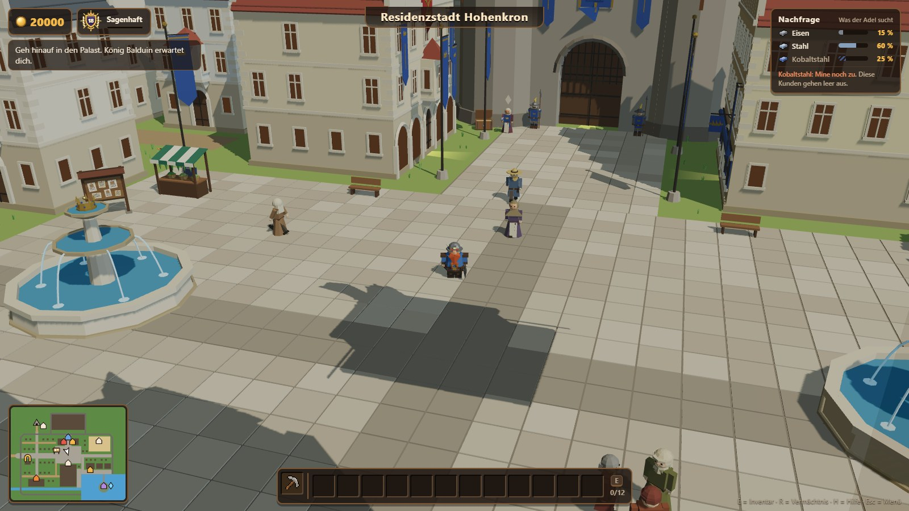

Später führt dich der Weg in die Stadt des Königs. Dort lernst du König Balduin und seinen Hof kennen. Hohenkron hat eine riesige Schmiede, eine eigene Grube, einen Hafen, ein Turnierfeld und am See einen alten Magierturm.

## Ausblick

Darauf arbeitest du hin.

| | |
|---|---|
| 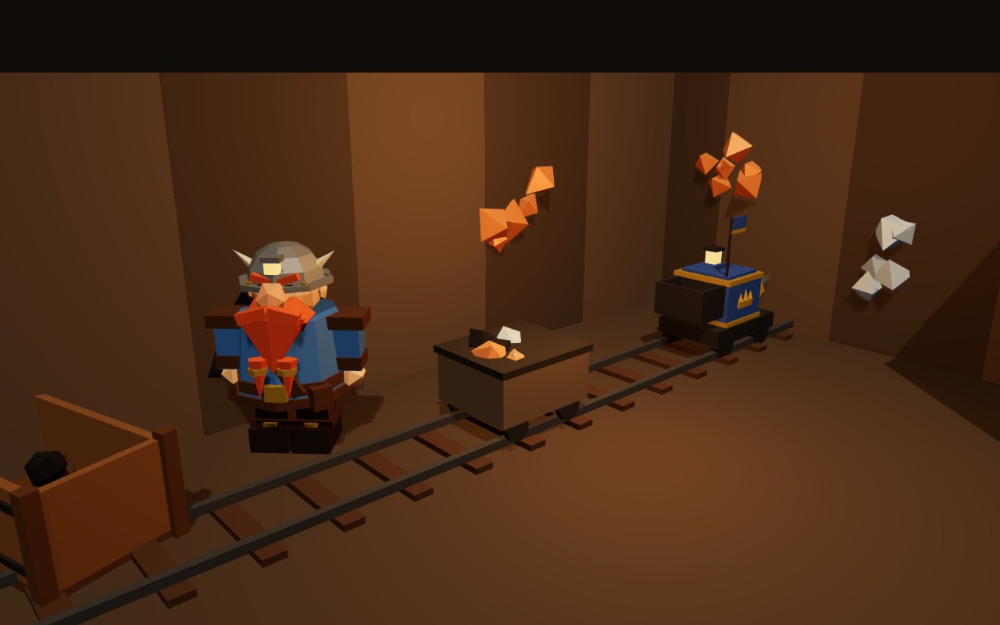 **Die Grubenbahn** Das Bergamt verkauft dir Bohrrechte. Bohrer und Loren holen das Erz, während du schmiedest. | 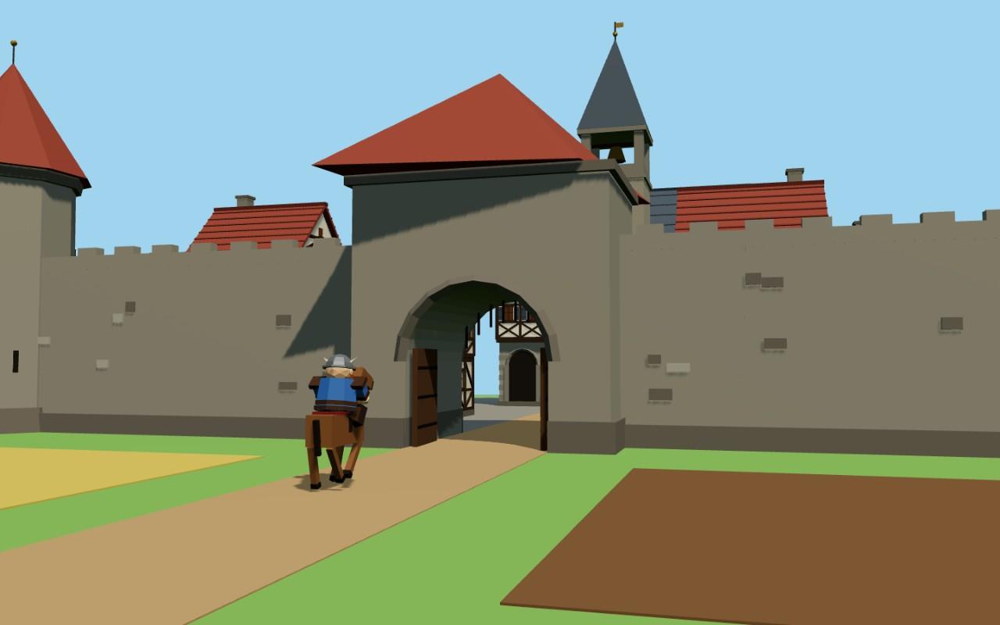 **Die Marktstadt Eisenfurt** Reicht dein Ruf über das Tal hinaus, reitest du in die Stadt. Dort warten die Große Schmiede mit ihrer Maschine, ein Kontor und Stahl aus dem Eisenstollen. |
| 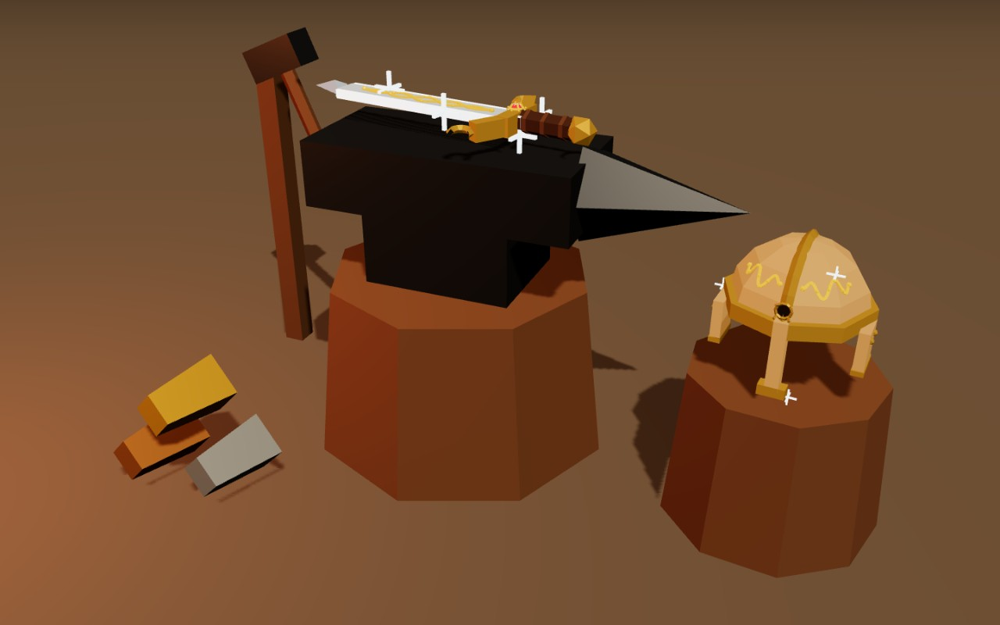 **Meisterstücke** Mit dem Meisterbrief der Gilde werden deine Bauteile meisterlich. Vier davon ergeben ein Meisterwerk. | 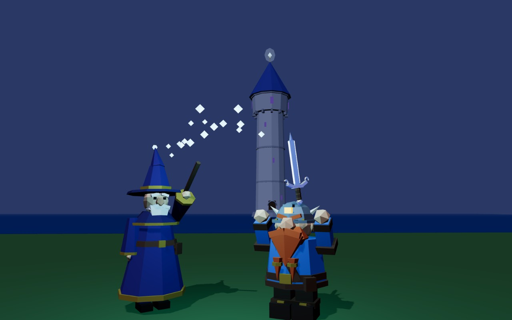 **Der Magierturm** Am See von Hohenkron steht ein alter Turm. Dort wohnt ein Magier. |
| 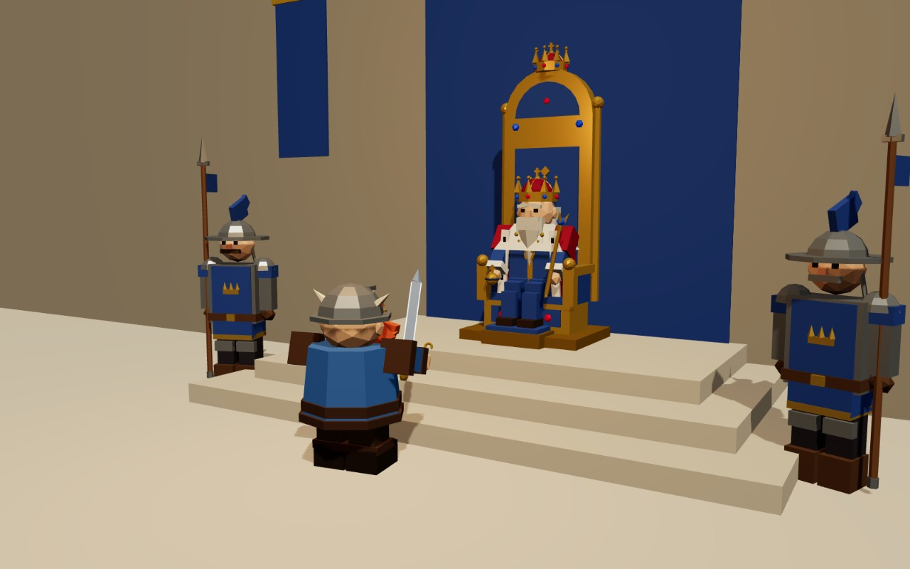 **Der Hof des Königs** In der Residenzstadt Hohenkron lernst du König Balduin kennen. Seine Gunst ist viel wert. | 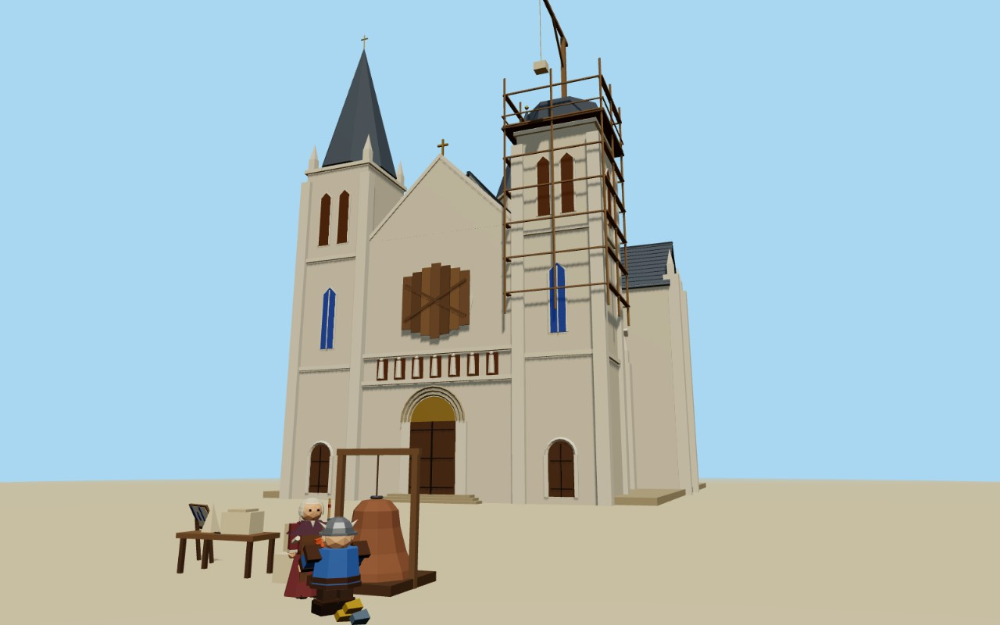 **Der Dom** Die Kathedrale von Hohenkron ist noch nicht fertig. Die Baumeisterin sucht Hilfe. |

## Gemacht aus Code

Alles im Spiel entsteht im Code: jedes Haus, jede Figur, jedes Schwert, dazu Musik und Geräusche. Es gibt keine Texturen und keine Sounddateien. Das Spiel ist mit Three.js gebaut und noch in Arbeit.
